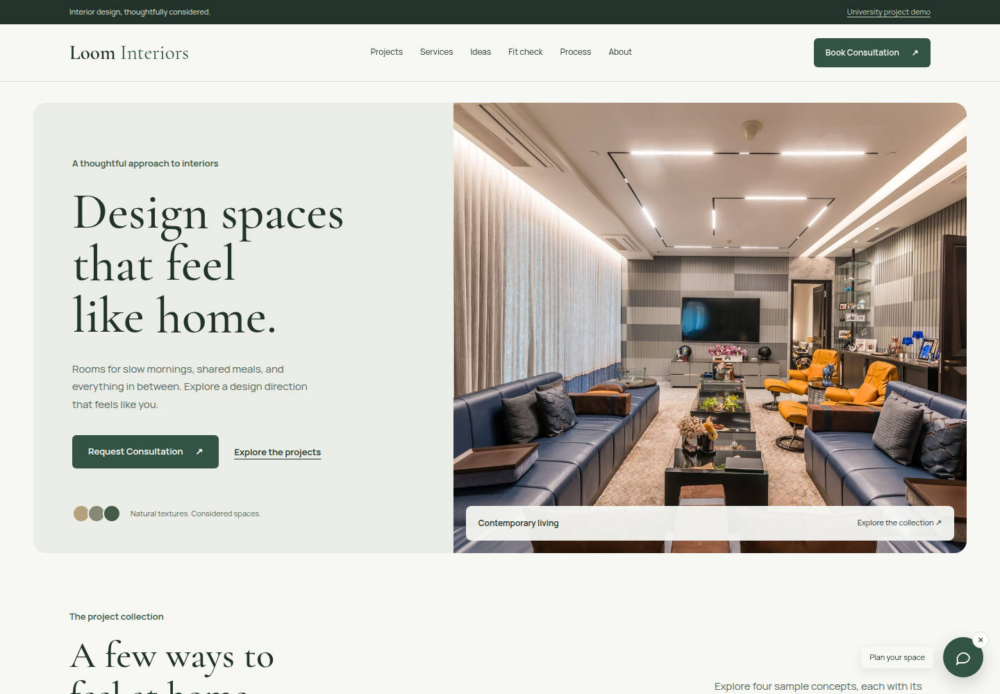

# Loom Interiors

A responsive React interior-design website prepared from a friend's supplied industrial-training project. The original archive and accompanying report describe a single-page studio website with a camera preview, draggable chat control, scroll progress, and a consultation form. This repository cleans up that source and makes the demonstration controls work.

[Open the public demo](https://raghav-56.github.io/loom-interiors/) · [Presentation guide](docs/presentation-guide.md) · [Report alignment](docs/report-alignment.md)



## Run locally

Install Node.js 22.12 or newer. In this folder, run:

```bash
npm ci
npm run dev
```

Open the localhost URL printed by Vite. Camera access requires localhost or HTTPS. Do not open `index.html` directly. For a production preview, run `npm run build` followed by `npm run preview`.

## Working interactions

- Responsive navigation and section links.
- Room, project, style, and chat selections prefill the consultation brief.
- Four sample project cards with accessible detail dialogs.
- Four selectable style directions and a live camera colour-tint preview.
- Camera denial fallback and explicit track cleanup when closing the camera.
- Draggable, removable chat button, fixed quick replies, and consultation navigation.
- Scroll percentage with passive listeners and animation-frame updates.
- Required-field, email, and phone validation with visible form feedback.
- Downloadable consultation brief. Nothing is sent to a server.

## Project structure

```text
src/pages/Home.jsx             Page composition
src/components/                React sections and controls
src/data/projects.js           Sample data and bundled image paths
css/style.css                  Studio design and responsive styles
assets/images/                 Optimized supplied photographs
tests/site.spec.js            Browser interaction checks
docs/                         Presentation and project notes
.github/workflows/             Checks and GitHub Pages deployment
```

## Verify

```bash
npx playwright install chromium
npm test
npm audit
```

Tests drive the built site at 1440, 1000, 640, and 400 pixels. They cover form validation and downloads, project dialogs, chat replies and dragging, style selection, camera denial, simulated camera cleanup, mobile navigation, and loaded images. A physical camera still needs a manual check on the presentation device.

## Demonstration boundaries

The studio and project descriptions are sample content, not verified business claims. The chat is rule-based. The camera applies a colour tint and does not perform augmented reality, recognition, or furniture placement. The form has no backend, database, booking system, or notification service. Enter sample details for demonstrations.

The PDF report, chat screenshots, original archive, migration backups, and bundled `node_modules` are deliberately excluded from this public repository.

## Source and attribution

The implementation is based on the user-supplied `loom-interiors-separated.rar`, identified by the user as their friend's project. The original supplied photographs remain in use after resizing and JPEG optimization. Their original creators and license terms were not supplied. This repository does not grant a separate license for those images or imply that they depict completed studio work.

Before using the original, [arshc0der/Interior_Design_Website](https://github.com/arshc0der/Interior_Design_Website) was reviewed as an MIT-licensed alternative. No source or assets were copied from it. See [research notes](docs/research.md).
